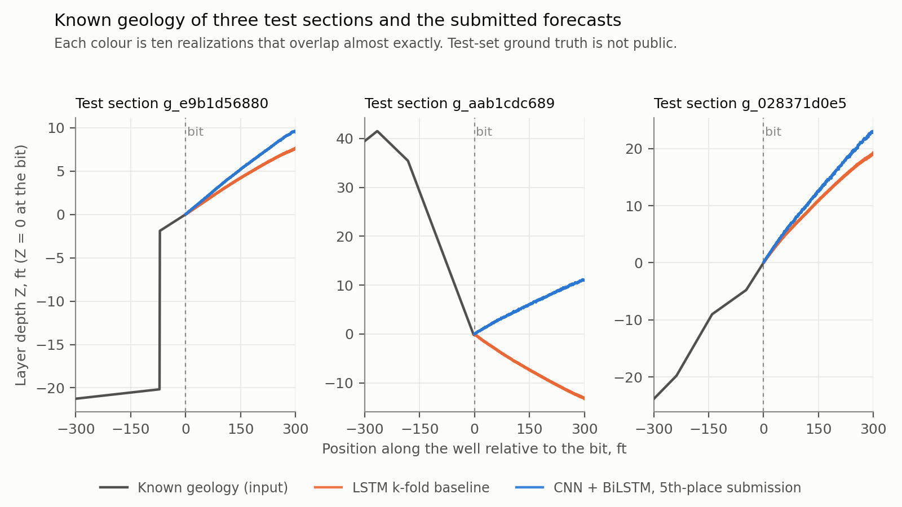
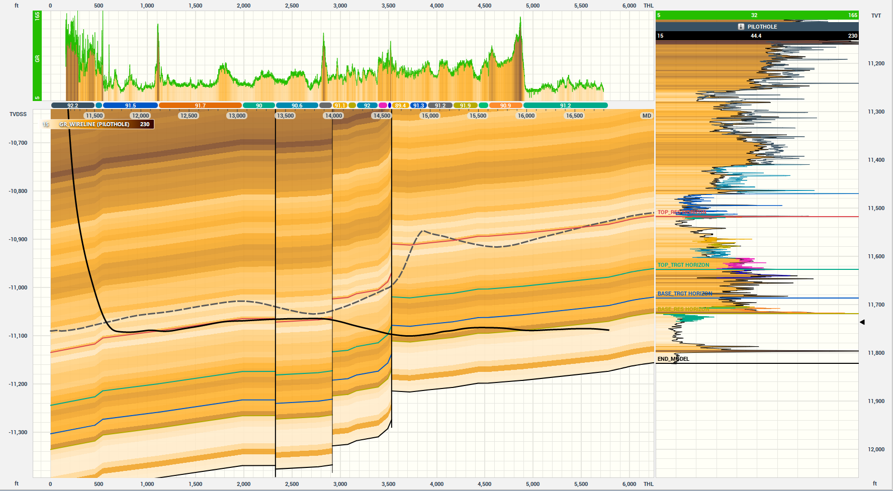

# Geology Forecast Challenge

Forecasting the depth of a geological layer 300 ft ahead of the drill bit of a horizontal well, from the 300 ft already drilled. This is my entry to the Kaggle [Geology Forecast Challenge](https://www.kaggle.com/competitions/geology-forecast-challenge-open), organised by NORCE with field data and prizes from ROGII. It finished 5th of 197 teams on the private leaderboard.



## The problem

While a horizontal well is being drilled, the geologist steering it needs to know where the target layer goes next. Each row of the data is a section of one layer boundary sampled every foot along the well. Columns `-299..0` hold the depth `Z` already interpreted behind the bit, shifted so that `Z(0) = 0`; the task is to predict positions `1..300` ahead of it. Only `-49..0` are guaranteed to be present: 929 of the 1510 training rows (62%) start later than `-299`. The test set has 524 rows.

Layers are mostly smooth, but faults shift them abruptly and dips change their slope, so a forecast has to carry its uncertainty. A submission therefore holds ten equally likely realizations of the 300 future depths for every row, 3000 numbers in all. In `train.csv` the nine extra realizations are copies of the true curve.


*A real well section with faults and dips. Figure from the competition overview (NORCE, ROGII).*

## Metric

For realization `i` the misfit is a weighted sum of squared errors over the 300 positions:

```math
q_i = \sum_{x=1}^{300} \frac{\left(b_T(x) - b_i(x)\right)^2}{\sigma^2(x)}, \qquad \sigma^2(x) = 600 \exp\left(a_k \ln x + b_k\right)
```

Here `b_T` is the true boundary and `(a_k, b_k)` take one of three values for `x` in `1..60`, `61..244` and `245..300` (`log_slopes = [1.0406, 0.0, 7.8353]`, `log_offsets = [-6.4307, -2.1617, -45.2488]`). The tolerance σ grows from 1 ft at the bit to 8.3 ft at 60 ft, stays there until 244 ft and reaches 18.5 ft at 300 ft. The score of a row is

```math
\text{score} = -\log\left(\frac{1}{10}\sum_{i=0}^{9} \exp(q_i)\right)
```

and the leaderboard shows its mean over rows. This is the formula on the evaluation page and in the organisers' scoring code ([nll-for-1d-geology-metric-v5](https://www.kaggle.com/code/alin256/nll-for-1d-geology-metric-v5)). With `+q_i` in the exponent the score is 0 for a perfect forecast and negative otherwise, higher is better, and it is pulled towards the worst of the ten curves.

The notebooks validate with `compute_nll_score`, which uses `exp(-q_i)`: the usual negative log-likelihood of a Gaussian mixture without its normalising constant, 0 at best and positive otherwise, lower is better, pulled towards the best curve. When the ten realizations coincide, the two formulas give `-q` and `+q`, the same number with opposite signs. In the six submission files of the results table the ten curves differ by 0.03 ft or less on average (standard deviation across realizations), against a tolerance of at least 1 ft, so for them the two formulas agree up to the sign. They part ways once the realizations spread out: on the leaderboard any spread around a single forecast lowers the expected score, while the local metric rewards it.

## Approach

All notebooks fill the missing part of the history with 0 and train on all 3000 target columns, so each network learns ten copies of the same curve.

**Baseline, `lstm-kfold.ipynb`.** A three-layer LSTM with 1024 hidden units reads the 300 known depths as a sequence. Its last hidden state goes through LayerNorm and a two-layer head to the 3000 outputs. The loss is MSE on targets standardised with the batch's column statistics. Training runs five folds of 30 epochs with AdamW and cosine warm restarts, and the test forecast is the mean of the five fold models.

**Main solution, `models-and-hyperparameters.ipynb`.** `engineer_features` builds 397 inputs from the history: means, deviations and linear trends of the last 5, 10 and 20 points, Savitzky-Golay smoothed values and slopes, FFT power of the last 32 points, the largest jump inside a 5-point window as a fault indicator, the dip angle of the last 10 points, the last 50 depths, squares of the summary features and the full raw history. They are standardised and fed to the model as a sequence of 397 scalars.

Four architectures share one training loop: an LSTM, a Transformer encoder, a dilated causal TCN, and a hybrid of four 1D convolutions (64, 128, 128 and 256 filters with BatchNorm and GELU) followed by a bidirectional LSTM and an MLP head. The loss adds a small penalty on step-to-step changes of the forecast to the standardised MSE. Training stops early after 10 epochs without improvement and drops runs whose validation loss is still above 1 after 12 epochs.

A Bayesian W&B sweep of 30 runs tuned the hybrid on an 80/20 split of the training rows: learning rate (3e-4 to 1e-2, log scale), dropout (0.1 to 0.3), 2 to 4 LSTM layers, weight decay, optimizer (AdamW or SGD) and scheduler (cosine annealing, ReduceLROnPlateau or OneCycle). Earlier sweeps also covered the plain LSTM and the TCN.

**Ten realizations.** Realization 0 is the network output. Realizations 1 to 9 add Gaussian noise to it, smoothed over about 5 positions, scaled up with the distance from the bit and capped in how much it can change from one foot to the next (`generate_diverse_realizations`). The generator receives all 3000 output columns, so within the 300 positions that are submitted its distance scaling reaches only 0.19 of the intended amplitude. In the 5th-place file the ten curves differ by 0.005 ft on average, and nowhere by more than 0.25 ft. The submissions are in effect one forecast repeated ten times, which is what the leaderboard metric favours.

**`hybrid-kfold.ipynb`** retrains one of the best sweep configurations of the hybrid with 5-fold cross-validation, a hand-written Ranger optimizer (RAdam with Lookahead), mixed precision, Mixup (α = 0.2), stochastic weight averaging from epoch 50, penalties on the slope and curvature of the forecast and up to 100 epochs. The test forecast averages the fold models.

**`xgboost-per-position.ipynb`** is the non-neural alternative. It adds slope, curvature and wavelet statistics of the last 50 points to the same features (415 in total), trains one XGBoost regressor for every fifth target position with 5-fold cross-validation and interpolates linearly in between. Optuna chose the parameters with a single trial on 10 random positions.

## Results

On the final private leaderboard this solution is 5th of 197 teams with −12.80; the winner scored −11.87 (`kaggle competitions leaderboard geology-forecast-challenge-open`). The entry is a CNN + BiLSTM run from the W&B sweeps of `models-and-hyperparameters.ipynb`, submitted on 22 April 2025 as `submission_HybridCNNLSTM_19.565297.csv`. It also has my best public score.

Twenty of my 33 submissions came from these notebooks; the rest were earlier experiments that are not in this repository. The table gives the best private score of each model family (`kaggle competitions submissions geology-forecast-challenge-open`). The validation NLL is the one the notebook printed, which also ends up in the submission file name.

| Notebook | Model | Submissions | Validation NLL (lower is better) | Public | Private |
|---|---|---|---|---|---|
| `models-and-hyperparameters` | CNN + BiLSTM | 7 | 19.57, 20% hold-out | −46.28 | **−12.80** |
| `hybrid-kfold` | CNN + BiLSTM, 5 folds | 2 | 24.61, 5-fold OOF | −46.80 | −13.30 |
| `models-and-hyperparameters` | LSTM | 4 | 19.71, 20% hold-out | −47.39 | −13.66 |
| `lstm-kfold` | LSTM, 5 folds | 1 | 25.37, 5-fold mean | −51.79 | −14.20 |
| `models-and-hyperparameters` | TCN | 4 | 19.25, 20% hold-out | −47.54 | −14.36 |
| `xgboost-per-position` | XGBoost | 2 | 25.42, 5-fold OOF | −48.65 | −14.89 |

The validation numbers do not compare across rows: a 20% hold-out is not a 5-fold estimate, and the XGBoost notebook scores its noisy realizations while the others score the raw network outputs. Even within the hold-out runs a lower local NLL did not reliably mean a better private score; the TCN at 19.25 ended at −14.36, the hybrid at 19.57 at −12.80. The two halves of the test set also differ a lot: the twenty files scored between −46.3 and −53.4 on the public part and between −12.8 and −16.7 on the private part.

The 30-run sweep of the hybrid is saved in the notebook outputs of commit `205e404`. The 28 AdamW runs reached a hold-out NLL between 19.06 and 22.80, apart from one OneCycle run at 28.42; both SGD runs failed to train and were stopped at epoch 12 with 119.8. ReduceLROnPlateau gave the best results (13 runs, median 19.51, and the three best runs), cosine annealing came next (11 runs, median 20.25) and OneCycle last (4 runs, median 22.27). The best run used a learning rate of 3.4e-3, dropout 0.15, two LSTM layers and weight decay 1e-4. `hybrid-kfold.ipynb` hard-codes the third-best (19.12: learning rate 1.6e-3, dropout 0.11, three LSTM layers, weight decay 1e-5).

The baseline's five folds scored 21.34, 32.93, 24.25, 25.26 and 23.07, about 4 minutes per fold on a Kaggle GPU.

## Notebooks

| Notebook | Role | Kaggle |
|---|---|---|
| [`lstm-kfold.ipynb`](lstm-kfold.ipynb) | Baseline: LSTM on the raw history, 5 folds | [qmarva/lstm-kfold](https://www.kaggle.com/code/qmarva/lstm-kfold) |
| [`models-and-hyperparameters.ipynb`](models-and-hyperparameters.ipynb) | Main solution: features, four architectures, W&B sweep, 5th-place submission | not published |
| [`hybrid-kfold.ipynb`](hybrid-kfold.ipynb) | 5-fold training of the tuned CNN + BiLSTM | not published |
| [`xgboost-per-position.ipynb`](xgboost-per-position.ipynb) | XGBoost per target position with Optuna | not published |

The last three share their first 36 code cells (data, features, models, training loop, metric). The saved outputs are partial: the sweep outputs of `models-and-hyperparameters.ipynb` were cleared and live in commit `205e404`, `hybrid-kfold.ipynb` shows the first fold of a run that was stopped by hand, and `xgboost-per-position.ipynb` was saved while the per-position training was still running.

```
.
├── lstm-kfold.ipynb
├── models-and-hyperparameters.ipynb
├── hybrid-kfold.ipynb
├── xgboost-per-position.ipynb
├── imgs/                              figures for this README
├── Dockerfile, docker-entrypoint.sh   GPU image with JupyterLab
├── requirements.txt
└── data/                              competition data after download, not tracked
```

## How to run

Download the data from the repository root with the [Kaggle CLI](https://github.com/Kaggle/kaggle-api). The account has to accept the competition rules on the competition page first.

```bash
kaggle competitions download -c geology-forecast-challenge-open
unzip geology-forecast-challenge-open.zip   # creates data/ with train.csv, test.csv, sample_submission.csv, train_raw/
```

The notebooks need a CUDA GPU. The Docker image has Python 3.10, PyTorch 2.5.1 for CUDA 12.1 and the packages from `requirements.txt`, and starts JupyterLab on port 8888 with the repository mounted:

```bash
echo "WANDB_API_KEY=<your key>" > .env
docker build -t geology-forecast .
docker run --rm -it --gpus all -p 8888:8888 --env-file .env -v "$(pwd)":/geology-forecast geology-forecast
```

Without Docker, `pip install -r requirements.txt` in a Python 3.10 environment and `jupyter lab` do the same. On Kaggle, attach the competition to the notebook: the data is then read from `/kaggle/input`, and the W&B key from a secret named `wandb`.

W&B is required for the sweep and for the Optuna search in `xgboost-per-position.ipynb`; elsewhere it is optional, and without `WANDB_API_KEY` the notebooks print a message and train without logging. `run_sweep(count=30)` in the last cell of `models-and-hyperparameters.ipynb` starts the sweep, and every run writes `submission_<model>_<validation NLL>.csv`. The other notebooks write one submission file each.

## Data

The data belongs to the competition: field data from ROGII Inc., prepared by NORCE Norwegian Research Centre and released under CC BY 4.0 according to the competition rules. It is not stored in this repository; the download above fetches it. Besides the three CSV files it contains `train_raw/`, the 123 well profiles the training rows were cut from, and `interpolate_and_split.py`, the organisers' script that did the cutting.

## Notes and limitations

Cross-validation splits rows at random. The rows are non-overlapping sections of 123 wells, so sections of the same well end up on both sides of a split and the local scores are optimistic. Grouping the folds by well would need the row-to-well mapping, which can be rebuilt from `train_raw/` with the organisers' script.

Several details of the pipeline affect the results, and fixing them would change the saved numbers, so the code keeps them. `GeologyDataset` fits a separate `StandardScaler` on the training, validation and test arrays, so validation and test inputs are scaled with their own statistics. The 397 features, most of them unordered summary statistics, reach the recurrent and convolutional models as a single sequence. The realization generator gets 3000 columns instead of 300, as described above, and the sweep's `diversity_factor` cannot affect the validation NLL, which is computed on the raw outputs.

In `lstm-kfold.ipynb` the validation score uses the last epoch's predictions while the test forecast uses the best checkpoint, and `seed_everything` is commented out, so a rerun gives slightly different numbers. In `hybrid-kfold.ipynb` the Lookahead counter of the Ranger optimizer advances once per parameter tensor rather than once per step, and the averaged SWA model keeps the BatchNorm statistics of the initial weights. In `xgboost-per-position.ipynb` the wavelet loop computes the same Ricker transform three times, so 8 of the 12 wavelet features are duplicates, Optuna ran a single trial, and `tree_method="gpu_hist"` is deprecated in XGBoost 3.

## References

1. Competition overview, data description and evaluation: [kaggle.com/competitions/geology-forecast-challenge-open](https://www.kaggle.com/competitions/geology-forecast-challenge-open).
2. Alyaev and Elsheikh (2022), the NLL loss applied to geological boundaries: [doi:10.1029/2021EA002186](https://doi.org/10.1029/2021EA002186).
3. Muhammad et al. (2024), geosteering with a particle filter, the use case named in the overview: [doi:10.2118/218444-MS](https://doi.org/10.2118/218444-MS).
